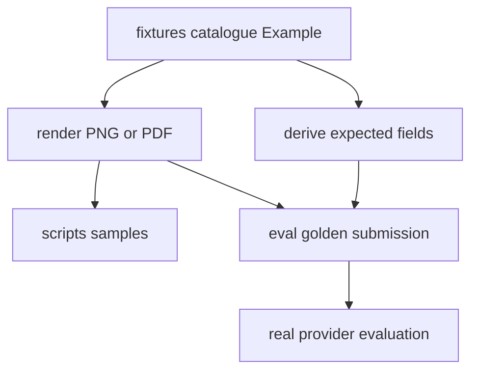

# Synthetic Fixtures and Golden Evaluation

The repository has two complementary quality systems. `tests/` uses `FakeModelProvider` and real API/queue/database/storage infrastructure for deterministic assertions. `eval/run_eval.py` runs the real Anthropic provider against generated golden documents and reports accuracy because model responses are probabilistic and billed. Manual provider-layout evidence is captured separately by the [manual reference capture workflow](manual-reference-capture.md) and should not be confused with generated fixtures.

## One authoring model, two generated surfaces

`fixtures/catalogue.py:EXAMPLES` is the canonical table of `Example` objects. An example carries its document type/version, `Submission` faces, `Row`/`Table`/`Mrz`-like elements, declared absent fields, and optional golden/sample destinations. The renderer builds a visual document; expectation projection reads values from the same element arguments. Therefore rendered evidence and `expected.json` are co-derived rather than separately maintained.

The diagram reflects `fixtures/generate.py`, `fixtures/surfaces.py`, and expectation/render functions.

### Semantic rules

- Give each printed evidence value a keyword named for the schema field; list deliberately unprinted top-level values in `absent` so they project as `null` when schema semantics permit. For arrays, `Table.into` projects nested rows and `absent_keys` supplies explicit `null` values for nested properties whose columns are intentionally unprinted.
- Use `fixtures.identifiers`, never realistic hand-written identifiers. It creates correctly shaped but deliberately invalid check-digit values for Hungarian tax numbers, personal identifiers, bank account numbers, and MRZ checks. The tests prove both shape and invalidity so committed examples cannot collide with real people or organizations.
- MRZ authoring is stricter than ordinary printed-name authoring. `mrz_td1` and `mrz_td3` produce TD1/TD3 geometry, break all MRZ check digits, transliterate unambiguous Hungarian diacritics per ICAO Doc 9303 §6.A, convert spaces and hyphens to fillers, and drop apostrophes. `AmbiguousTransliteration` refuses characters such as `Ö` and `Ü` because the standard offers state-dependent alternatives and the inspected Hungarian sources do not settle the choice.
- Quote identity-document labels, placement, dates, MRZ observations, and unsourced gaps from `docs/research/hungarian-document-printed-labels.md`, not from memory or generic standards. That research now records that current eID and address cards mix label placements on the same physical document; `fixtures/render.py:CARD` still stacks labels uniformly, so it is a low-fidelity fixture renderer rather than a faithful card-layout engine.
- The renderer refuses overflowing headings, cells, and faces (`FixtureDoesNotFit`) and uses vendored DejaVu fonts so Hungarian accented text remains distinguishable. `CARD` and `SHEET` are geometry presets, not per-document-type layouts; adding a fifth document style or a placement knob must update rendering and expectation coverage together.

Run `uv run python -m fixtures.generate` after data-table changes. It overwrites manual samples in `scripts/samples/` and golden submissions plus `expected.json` under `eval/golden/`. Do not edit generated image or expectation output independently. `tests/test_fixture_renderer.py` verifies projection semantics, nested nulls, synthetic identifier invalidity, MRZ transliteration/refusal behavior, font/layout determinism, schema conformance, and committed sample/golden drift. Run `uv run pytest tests/test_fixture_renderer.py` for fixture/schema change validation.

## Change navigation

| Intent | Implementation seam | Focused test or command |
| --- | --- | --- |
| Add or change a generated fixture | `fixtures/catalogue.py:EXAMPLES` using public names re-exported by `fixtures/__init__.py` | `uv run python -m fixtures.generate` then `uv run pytest tests/test_fixture_renderer.py` |
| Add a new rendered element or geometry | `fixtures/model.py`, `fixtures/render.py`, and the matching expectation projection | Add or extend renderer tests in `tests/test_fixture_renderer.py`; then run `uv run pytest tests/test_fixture_renderer.py` |
| Add an identifier or MRZ rule | `fixtures/identifiers.py` constructors and validators | Add analogous shape, invalidity, and refusal tests in `tests/test_fixture_renderer.py`; run `uv run pytest tests/test_fixture_renderer.py` |
| Evolve a schema field that fixtures should prove | [Schema registry and document type authoring](../schemas/registry-and-authoring.md), then `fixtures/catalogue.py` | `uv run pytest tests/test_schema_registry.py tests/test_fixture_renderer.py tests/test_extraction_validation.py` |
| Compare generated invoices with an external provider layout | [Manual reference capture](manual-reference-capture.md) | `bash scripts/issue_demo_invoice_wizard.sh`; no deterministic app test exists because this is human-operated external research |

## Golden evaluation

`eval/run_eval.py` discovers every `expected.json` recursively, requires exactly one adjacent supported `submission.*`, creates a temporary submission/job in real PostgreSQL/S3, and calls `process_job` directly with `RetryingModelProvider(AnthropicModelProvider)`. It then reloads that job with documents and fields for scoring. A fully correct example must produce exactly one document, match expected classification type/version, and match every listed expected field; top-level numeric values tolerate ±0.01, while other values, including nested structures, compare exactly. It prints type and field accuracy and exits nonzero if any example is not fully correct.

Run `uv run python eval/run_eval.py` only with infrastructure, migrations, and a configured Anthropic credential; it performs billed external calls and uses runtime settings described in [runtime configuration and validation](../operations/runtime-and-validation.md). `--model` and `--golden-dir` are explicit overrides. The committed golden set currently covers invoice v2 happy/simplified examples; the evaluation README records planned identity-document examples. This harness is an accuracy report, not a deterministic replacement for tests.
