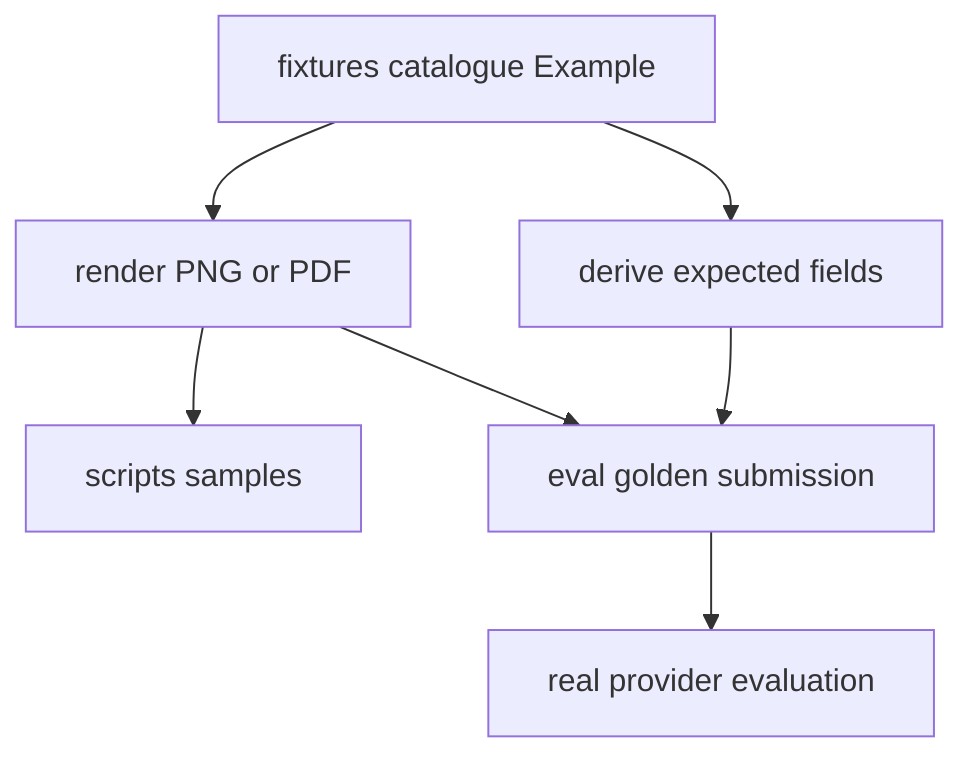

# Synthetic Fixtures and Golden Evaluation

The repository has two complementary quality systems. `tests/` uses `FakeModelProvider` and real API/queue/database/storage infrastructure for deterministic assertions. `eval/run_eval.py` runs the real Anthropic provider against generated golden documents and reports accuracy because model responses are probabilistic and billed.

## One authoring model, two generated surfaces

`fixtures/catalogue.py:EXAMPLES` is the canonical table of `Example` objects. An example carries its document type/version, `Submission` faces, `Row`/`Table`/`Mrz` elements, declared absent fields, and optional golden/sample destinations. The renderer builds a visual document; expectation projection reads values from the same element arguments. Therefore rendered evidence and `expected.json` are co-derived rather than separately maintained.

The diagram reflects `fixtures/generate.py`, `fixtures/surfaces.py`, and expectation/render functions.

### Semantic rules

- Give each printed evidence value a keyword named for the [schema](../schemas/registry-and-authoring.md) field; list deliberately unprinted top-level values in `absent` so they project as `null` when schema semantics permit.
- `Table.into` projects nested arrays. Each nested property required by the schema must be represented; a missing printed column uses explicit `null`, not a missing key. This matters for invoice line items and VAT summaries.
- Use `fixtures.identifiers`, never realistic hand-written identifiers. It creates correctly shaped but deliberately invalid check-digit values for tax numbers, personal identifiers, bank accounts, and ICAO MRZ fields, avoiding accidental real identifiers while retaining extraction realism.
- MRZ text is a transcription fixture, not a validation fixture. `mrz_td1` and `mrz_td3` transliterate Hungarian accented names according to ICAO Doc 9303 where the table is unambiguous (`ÁÉÍÓŐÚŰ` become single ASCII letters), turn spaces and hyphens into `<`, drop apostrophes, and deliberately raise `AmbiguousTransliteration` for `Ö` and `Ü` because the captured Hungarian sources do not settle which state-dependent transliteration Hungary uses.
- The renderer refuses overflowing headings/cells/faces (`FixtureDoesNotFit`) and uses vendored DejaVu fonts so Hungarian accented text is distinguishable.

Run `uv run python -m fixtures.generate` after data-table changes. It overwrites manual samples in `scripts/samples/` and golden submissions plus `expected.json` under `eval/golden/`. Do not edit generated image or expectation output independently.

`tests/test_fixture_renderer.py` verifies projection semantics, nested nulls, synthetic identifier invalidity, MRZ geometry/transliteration, font/layout determinism, schema conformance, and committed sample/golden drift. Run `uv run pytest tests/test_fixture_renderer.py` for fixture/schema change validation.

### Renderer fidelity boundaries

`fixtures/render.py` intentionally has only two geometries: `CARD` for ID-1-style identity documents and `SHEET` for invoices. The shared card geometry stacks labels uniformly, but the PRADO-derived research in `docs/research/hungarian-document-printed-labels.md` now records that real eID and address cards mix stacked labels, inline pairs, right-aligned values, tab stops, and second columns on one physical document. The same renderer also cannot draw the driving licence's rotated verso legend. Treat those as known fidelity boundaries when authoring identity fixtures: the renderer is designed to print the right words and values without drift, not to recreate every placement rule.

If a change adds a new visual element type, update both projections: drawing in `fixtures/render.py` and expectation derivation in `fixtures/expectations.py`. `assert_never` branches exist so a new element cannot silently appear in `expected.json` while drawing nothing, or vice versa.

## External invoice layout reference

`scripts/issue_demo_invoice_wizard.sh` is a manual wizard for obtaining a Számlázz.hu demófiók invoice as layout evidence. It is not application configuration and it does not write committed fixture output: by default it records observations in `$HOME/document-intelligence-reference/invoices/demofiok-notes.env` and asks the operator to save the downloaded PDF outside the working tree. The stages gate on a clearly synthetic issuer, use the same synthetic buyer as the invoice happy-path fixture, avoid correcting the deliberately invalid buyer tax-number check digit, and record whether the final PDF has a `MINTA` watermark.

Use the wizard when invoice fixture authors need provider-generated layout evidence that the committed `SHEET` renderer does not capture. Do not replace `fixtures/catalogue.py` or generated golden artifacts with that PDF; translate any accepted evidence back into the data-table and renderer workflow above.

## Golden evaluation

`eval/run_eval.py` discovers every `expected.json` recursively, requires exactly one adjacent supported `submission.*`, creates a temporary submission/job in real PostgreSQL/S3, and calls `process_job` directly with `RetryingModelProvider(AnthropicModelProvider)`. It then reloads that job with documents and fields for scoring. A fully correct example must produce exactly one document, match expected classification type/version, and match every listed expected field; top-level numeric values tolerate ±0.01, while other values (including nested structures) compare exactly. It prints type and field accuracy and exits nonzero if any example is not fully correct. This is the billed real-provider counterpart to the deterministic fixture tests and therefore depends on the [model provider adapter](../model-provider/adapter-and-retries.md).

Run `uv run python eval/run_eval.py` only with infrastructure, migrations, and a configured Anthropic credential; it performs billed external calls. `--model` and `--golden-dir` are explicit overrides. The committed golden set currently covers invoice v2 happy/simplified examples; the evaluation README records planned identity-document examples. This harness is an accuracy report, not a deterministic replacement for tests.

## Change navigation

| Intent | Start here | Watch for | Focused validation |
| --- | --- | --- | --- |
| Add or revise a committed fixture/golden example | `fixtures/catalogue.py:EXAMPLES` plus `fixtures/model.py` | Quote printed labels from research, use `fixtures.identifiers`, and regenerate instead of editing output files | `uv run python -m fixtures.generate && uv run pytest tests/test_fixture_renderer.py` |
| Change renderer geometry, overflow behavior, fonts, or supported visual elements | `fixtures/render.py`, `fixtures/expectations.py` | Keep page drawing and expected-field projection in lockstep; current card geometry is not placement-accurate for every identity document | `uv run pytest tests/test_fixture_renderer.py` |
| Change identifier or MRZ construction | `fixtures/identifiers.py` | Preserve the deliberately broken check-digit invariant and refuse unresolved transliteration choices instead of guessing | `uv run pytest tests/test_fixture_renderer.py -k "identifier or mrz or transliteration or check_digit"` |
| Collect external invoice layout evidence | `scripts/issue_demo_invoice_wizard.sh` | Save observations/PDF outside the repo and keep committed fixtures generated from `EXAMPLES` | Run the wizard manually; no deterministic test is expected until evidence is encoded in fixtures |
| Investigate real-provider accuracy | `eval/run_eval.py` | Requires infrastructure and a real Anthropic credential; billed and probabilistic, so do not use as default validation | `uv run python eval/run_eval.py` |
