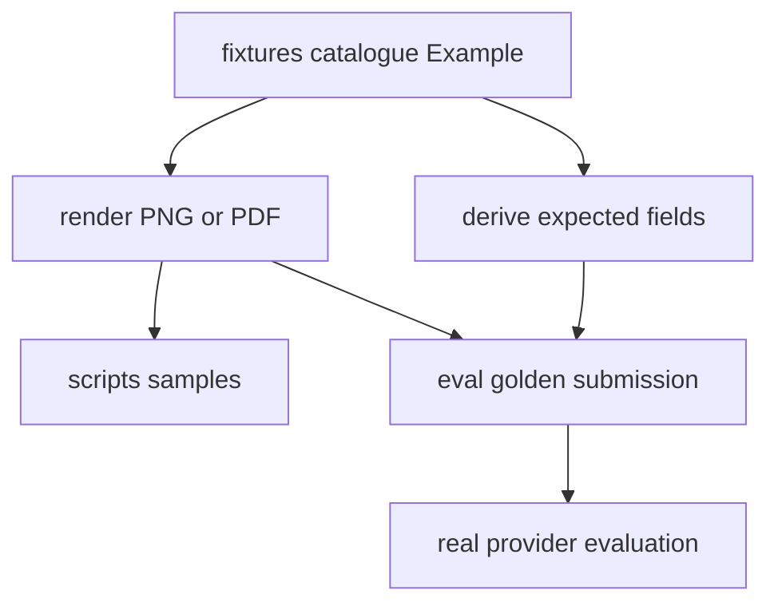
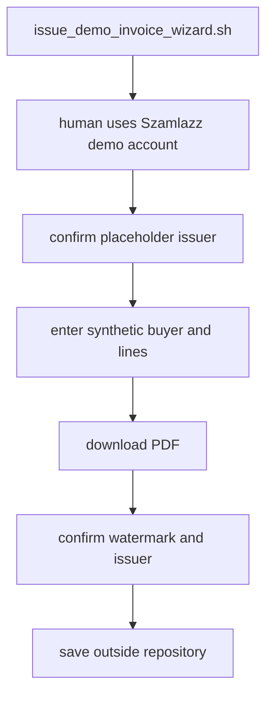

# Synthetic Fixtures, Reference Artifacts, and Golden Evaluation

The repository has two complementary quality systems plus one manual reference-artifact workflow. `tests/` uses `FakeModelProvider` and real API/queue/database/storage infrastructure for deterministic assertions. `eval/run_eval.py` runs the real Anthropic provider against generated golden documents and reports accuracy because model responses are probabilistic and billed. `scripts/issue_demo_invoice_wizard.sh` helps a human capture a Számlázz.hu demófiók invoice PDF outside the repository for future layout research; it is not a fixture generator and it is not deterministic validation.

The generated fixture surfaces feed the [schema registry](../schemas/registry-and-authoring.md) and the extraction path documented in the [processing pipeline](../pipeline/processing.md). The paid golden evaluation exercises the same provider adapter described in [model provider adapter and retry policy](../model-provider/adapter-and-retries.md), but with real Anthropic calls instead of `FakeModelProvider`.

## One authoring model, two generated surfaces

`fixtures/catalogue.py:EXAMPLES` is the canonical table of `Example` objects. An example carries its document type/version, `Submission` faces, `Row`/`Table`/`Mrz`-like elements, declared absent fields, and optional golden/sample destinations. The renderer builds a visual document; expectation projection reads values from the same element arguments. Therefore rendered evidence and `expected.json` are co-derived rather than separately maintained.

The diagram reflects `fixtures/generate.py`, `fixtures/surfaces.py`, and expectation/render functions.

### Semantic rules

- Give each printed evidence value a keyword named for the schema field; list deliberately unprinted top-level values in `absent` so they project as `null` when schema semantics permit.
- `Table.into` projects nested arrays. Each nested property required by the schema must be represented; a missing printed column uses explicit `null`, not a missing key. This matters for invoice line items and VAT summaries.
- Use `fixtures.identifiers`, never realistic hand-written identifiers. It creates correctly shaped but deliberately invalid check-digit values, including ICAO-style MRZ check digits, avoiding accidental real identifiers while retaining extraction realism.
- MRZ names are transliterated in `fixtures/identifiers.py` before `mrz_td1`/`mrz_td3` build the zone. `Á`, `É`, `Í`, `Ó`, `Ő`, `Ú`, and `Ű` map to one ICAO Doc 9303 §6.A letter; spaces and hyphens become `<`; apostrophes are dropped without a filler. `AmbiguousTransliteration` is raised for letters such as `Ö` and `Ü` because the standard offers multiple state-dependent spellings and the inspected Hungarian evidence does not settle which one Hungary writes. Choose a fixture holder name without those characters rather than asserting a guessed zone.
- The renderer refuses overflowing headings/cells/faces (`FixtureDoesNotFit`) and uses vendored DejaVu fonts so Hungarian accented text is distinguishable.
- `fixtures/render.py` deliberately remains lower-fidelity than PRADO specimens. `docs/research/hungarian-document-printed-labels.md` §6 shows the eID and address card mix stacked, inline, tab-stop, and right-aligned labels on the same document, while the current `card` geometry stacks values uniformly and cannot draw the driving-licence rotated verso legend. Treat this as a known fidelity seam: changing it should start from the research note and renderer geometry, not from per-document-type assumptions.

Run `uv run python -m fixtures.generate` after data-table changes. It overwrites manual samples in `scripts/samples/` and golden submissions plus `expected.json` under `eval/golden/`. Do not edit generated image or expectation output independently.

`tests/test_fixture_renderer.py` verifies projection semantics, nested nulls, synthetic identifier invalidity, font/layout determinism, schema conformance, and committed sample/golden drift. The MRZ-specific suites are named `test_the_zone_transliterates_every_hungarian_diacritic_to_one_letter`, `test_the_zone_drops_an_apostrophe_without_leaving_a_filler`, and `test_the_zone_refuses_a_letter_9303_transliterates_more_than_one_way`; search those names when changing transliteration or accepted fixture names. Run `uv run pytest tests/test_fixture_renderer.py` for fixture/schema change validation.

## Számlázz.hu demo-invoice reference wizard

`scripts/issue_demo_invoice_wizard.sh` is a Bash wizard for issue #68. It walks a human through Számlázz.hu's public demófiók, gates on whether the issuer and downloaded PDF are clearly synthetic, and asks the operator to save the downloaded provider PDF outside the working tree under `$HOME/document-intelligence-reference/invoices`. Observations are written to `${ENV_FILE:-$HOME/document-intelligence-reference/invoices/demofiok-notes.env}`; this file records third-party UI facts and is not the application `.env` consumed by [runtime configuration](../operations/runtime-and-validation.md).

This manual flow intentionally keeps the provider PDF out of committed generated fixtures until the product decision about provider PDFs is made.

Use `bash -n scripts/issue_demo_invoice_wizard.sh` as the narrow non-interactive check after editing the wizard library or stages. Running the script itself is an operator workflow, not a test: it opens browser pages, prompts for facts, may write an external notes file, and should not be used in CI. Do not store or document real issuer/buyer secrets; the wizard's buyer values are synthetic and its issuer gate exists to stop accidental real-company artifacts from entering fixture work.

## Golden evaluation

`eval/run_eval.py` discovers every `expected.json` recursively, requires exactly one adjacent supported `submission.*`, creates a temporary submission/job in real PostgreSQL/S3, and calls `process_job` directly with `RetryingModelProvider(AnthropicModelProvider)`. It then reloads that job with documents and fields for scoring. A fully correct example must produce exactly one document, match expected classification type/version, and match every listed expected field; top-level numeric values tolerate ±0.01, while other values (including nested structures) compare exactly. It prints type and field accuracy and exits nonzero if any example is not fully correct.

Run `uv run python eval/run_eval.py` only with infrastructure, migrations, and a configured Anthropic credential; it performs billed external calls. `--model` and `--golden-dir` are explicit overrides. The committed golden set currently covers invoice v2 happy/simplified examples; the evaluation README records planned identity-document examples. This harness is an accuracy report, not a deterministic replacement for tests.
