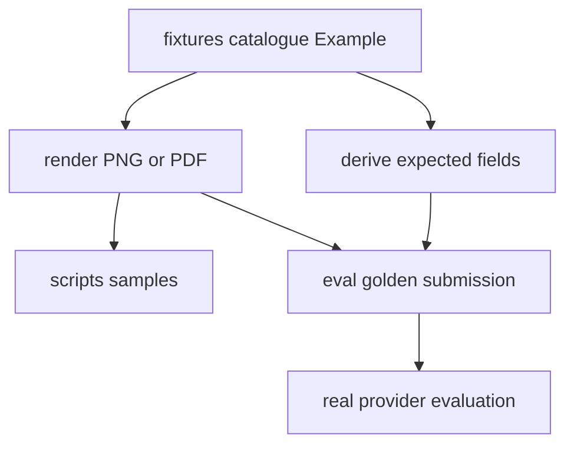

# Synthetic Fixtures and Golden Evaluation

The repository has two complementary quality systems. `tests/` uses `FakeModelProvider` and real API/queue/database/storage infrastructure for deterministic assertions, while the [model provider adapter](../model-provider/adapter-and-retries.md) is exercised by `eval/run_eval.py` with the real Anthropic provider against generated golden documents because model responses are probabilistic and billed.

## One authoring model, two generated surfaces

`fixtures/catalogue.py:EXAMPLES` is the canonical table of `Example` objects. An example carries its document type/version, `Submission` faces, `Row`/`Table`/`Mrz`-like elements, declared absent fields, and optional golden/sample destinations. The renderer builds a visual document; expectation projection reads values from the same element arguments. Therefore rendered evidence and `expected.json` are co-derived rather than separately maintained.

The diagram reflects `fixtures/generate.py`, `fixtures/surfaces.py`, and expectation/render functions.

### Semantic and safety rules

- Give each printed evidence value a keyword named for the schema field; list deliberately unprinted top-level values in `absent` so they project as `null` when schema semantics permit.
- `Table.into` projects nested arrays. Each nested property required by the schema must be represented; a missing printed column uses explicit `null`, not a missing key. This matters for invoice line items and VAT summaries.
- Use `fixtures.identifiers`, never realistic hand-written identifiers. It creates correctly shaped but deliberately invalid check-digit values for Hungarian tax numbers, personal identifiers, bank accounts, and ICAO MRZ fields, avoiding accidental real identifiers while retaining extraction realism.
- MRZ authoring is stricter than ordinary printed text. `_transliterate` uppercases names, turns spaces and hyphens into `<`, drops apostrophes, maps the Hungarian letters that ICAO Doc 9303 Part 3 §6.A resolves one way (`Á É Í Ó Ő Ú Ű`), and raises `AmbiguousTransliteration` for state-dependent characters such as `Ö` and `Ü` rather than guessing a zone Hungary may not print.
- The renderer refuses overflowing headings/cells/faces (`FixtureDoesNotFit`) and uses vendored DejaVu fonts so Hungarian accented text is distinguishable. `render_pdf_bytes` suppresses Pillow's wall-clock PDF metadata, so committed sample PDFs are byte-comparable like PNGs.

Run `uv run python -m fixtures.generate` after data-table changes. It overwrites manual samples in `scripts/samples/` and golden submissions plus `expected.json` under `eval/golden/`. Do not edit generated image, PDF, or expectation output independently.

`tests/test_fixture_renderer.py` verifies projection semantics, nested nulls, synthetic identifier invalidity, MRZ transliteration/refusal rules, font/layout determinism, [schema](../schemas/registry-and-authoring.md) conformance, PDF metadata stability, and committed sample/golden drift. Run `uv run pytest tests/test_fixture_renderer.py` for fixture/schema change validation.

## Identity-document fixture authoring notes

Identity fixture labels must be quoted from `docs/research/hungarian-document-printed-labels.md`, but that research note now separates wording from placement. Sections 1–5 provide the printed labels; §6 records mixed placement on the eID and address card; §7 records corrections such as the eID TD1 document code `I<`, the licence category-table and legend details, and MRZ transliteration findings. Do not infer a single per-document layout from the label tables.

`fixtures/render.py` currently offers two geometries: `card` stacks values under labels and `sheet` uses an invoice-style label column. The `card` geometry is an intentional low-fidelity seam, not an exact representation of every identity card: the eID mixes stacked rows, inline pairs, and right-aligned values; the address card mixes inline, tab-stop, right-column, and stacked placement; the driving licence has a rotated verso legend the renderer cannot draw. Source comments state that changing this is fidelity work owned by the renderer seam, not a prerequisite for classification accuracy, because measured placement/legend changes did not materially affect extraction.

When adding an identity example to `fixtures/catalogue.py`, use the public fixture surface exported from `fixtures/__init__.py` (`Example`, `Submission`, `Face`, `Row`, `Table`, `Mrz`, `identifiers`) and let schema conformance be checked by `test_every_catalogued_example_asserts_only_fields_its_schema_defines`. If a new fixture needs a character `fixtures.identifiers` refuses, either supply a source-backed transliteration rule and tests or choose a name without that character; do not hand-edit the generated MRZ string to bypass `AmbiguousTransliteration`.

## Manual demo-invoice evidence

`scripts/issue_demo_invoice_wizard.sh` is a human-operated workflow for issuing a synthetic Számlázz.hu demófiók invoice as an external layout reference. It is not part of the FastAPI runtime and it does not write repository configuration: by default it records observations under `$HOME/document-intelligence-reference/invoices/demofiok-notes.env`, then asks the user to save the downloaded PDF outside the working tree.

The wizard deliberately mirrors the `invoice/happy_path` buyer and line-item shape where possible, but it omits the golden fixture's reverse-charge and exemption lines because the provider UI may not expose those markings. Its safety gates matter more than the happy path: confirm the issuer is a dummy before entering data, keep the buyer's deliberately invalid check-digit adószám unchanged, verify any `MINTA` watermark on the downloaded PDF, and stop rather than commit or keep the PDF if the issuer appears real. Treat the resulting PDF as layout/research evidence for files that can later travel through the [HTTP submission path](../api/http-api.md); deterministic test and evaluation artifacts still come from `fixtures/catalogue.py` and `uv run python -m fixtures.generate`.

## Golden evaluation

`eval/run_eval.py` discovers every `expected.json` recursively, requires exactly one adjacent supported `submission.*`, creates a temporary submission/job in real PostgreSQL/S3, and calls `process_job` directly with `RetryingModelProvider(AnthropicModelProvider)`. It then reloads that job with documents and fields for scoring. A fully correct example must produce exactly one document, match expected classification type/version, and match every listed expected field; top-level numeric values tolerate ±0.01, while other values (including nested structures) compare exactly. It prints type and field accuracy and exits nonzero if any example is not fully correct.

Run `uv run python eval/run_eval.py` only with infrastructure, migrations, and a configured Anthropic credential; it performs billed external calls. `--model` and `--golden-dir` are explicit overrides. The committed golden set currently covers invoice v2 happy/simplified examples; the evaluation README records planned identity-document examples. This harness is an accuracy report, not a deterministic replacement for tests.
