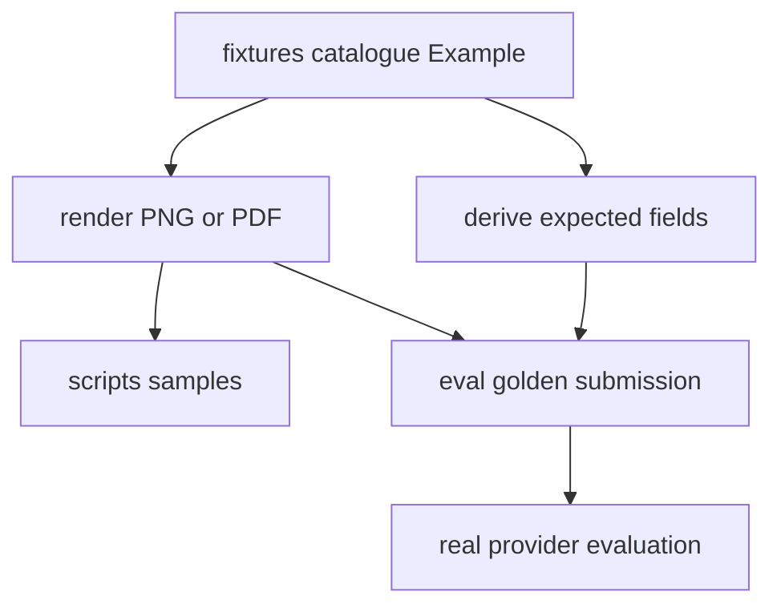

# Synthetic Fixtures and Golden Evaluation

The repository has two complementary quality systems. `tests/` uses `FakeModelProvider` and real API/queue/database/storage infrastructure for deterministic assertions. `eval/run_eval.py` runs the real Anthropic provider against generated golden documents and reports accuracy because model responses are probabilistic and billed. Fixture outputs feed the schema and runtime checks documented in [schema registry and document type authoring](../schemas/registry-and-authoring.md), [processing pipeline](../pipeline/processing.md), and [model provider adapter and retry policy](../model-provider/adapter-and-retries.md).

## One authoring model, two generated surfaces

`fixtures/catalogue.py:EXAMPLES` is the canonical table of `Example` objects. An example carries its document type/version, `Submission` faces, `Row`/`Table`/`Mrz`-like elements, declared absent fields, and optional golden/sample destinations. The renderer builds a visual document; expectation projection reads values from the same element arguments. Therefore rendered evidence and `expected.json` are co-derived rather than separately maintained.

The diagram reflects `fixtures/generate.py`, `fixtures/surfaces.py`, and expectation/render functions.

### Semantic rules

- Give each printed evidence value a keyword named for the schema field; list deliberately unprinted top-level values in `Example.absent` so they project as `null` when schema semantics permit.
- `Table.into` projects nested arrays. Each nested property required by the schema must be represented; a missing printed column uses explicit `null` via `Table.absent_keys`, not a missing key. This matters for invoice line items and VAT summaries.
- Use `fixtures.identifiers`, never realistic hand-written identifiers. It creates correctly shaped but deliberately invalid check-digit values for adószám, személyi azonosító, bank-account groups, and ICAO-style MRZ fields, avoiding accidental real identifiers while retaining extraction realism.
- MRZ names are transliterated by `fixtures.identifiers._transliterate` before `mrz_td1`/`mrz_td3` build TD1 or TD3 lines. Hungarian letters with one ICAO Doc 9303 §6.A spelling (`Á`, `É`, `Í`, `Ó`, `Ő`, `Ú`, `Ű`) are converted to one ASCII letter; apostrophes are dropped; spaces and hyphens become `<`; letters with state-dependent alternatives such as `Ö` and `Ü` raise `AmbiguousTransliteration` rather than guessing.
- The renderer refuses overflowing headings/cells/faces (`FixtureDoesNotFit`) and uses vendored DejaVu fonts so Hungarian accented text is distinguishable.

Run `uv run python -m fixtures.generate` after data-table changes. It overwrites manual samples in `scripts/samples/` and golden submissions plus `expected.json` under `eval/golden/`. Do not edit generated image or expectation output independently.

`tests/test_fixture_renderer.py` verifies projection semantics, nested nulls, synthetic identifier invalidity, MRZ transliteration/refusal behavior, font/layout determinism, schema conformance, and committed sample/golden drift. Stable tests worth searching for include `test_the_zone_transliterates_every_hungarian_diacritic_to_one_letter`, `test_the_zone_drops_an_apostrophe_without_leaving_a_filler`, `test_the_zone_refuses_a_letter_9303_transliterates_more_than_one_way`, and the stale-output tests near the end of the file. Run `uv run pytest tests/test_fixture_renderer.py` for fixture/schema change validation.

## Renderer fidelity and external research

`fixtures/render.py` intentionally separates element vocabulary from page geometry. `CARD` and `SHEET` define the current geometry knobs; `_draw_elements`, `_draw_table`, and `_draw_mrz` render `Row`, `Table`, and `Mrz` elements; `render_submission` adds the specimen wash and produces PNG/PDF bytes. A new element type must be implemented in both the renderer and `fixtures/expectations.py`, because the `assert_never` guards exist to prevent a page from silently omitting a value that still appears in `expected.json`.

Identity-card layout fidelity is deliberately limited. `docs/research/hungarian-document-printed-labels.md` is the source for label wording and the latest placement findings: eID and address-card specimens mix stacked labels, inline rows, right-aligned values, label columns, and face-specific placement. The current `CARD` geometry uniformly stacks rows and cannot draw the driving licence's rotated verso legend, so future fidelity work should treat #60 as a real layout-model decision rather than adding a one-flag per-document placement knob. The measured extraction impact recorded in `fixtures/render.py` was negligible for label placement and licence legend presence; those changes are fidelity work, not a default accuracy escalation.

## Manual Számlázz.hu invoice reference wizard

`scripts/issue_demo_invoice_wizard.sh` is a manual wizard for capturing a Számlázz.hu demófiók invoice PDF as an external layout reference. It is not an app runtime script and does not generate committed fixtures. The script opens the public demo account, gates on the issuer looking like a placeholder rather than a real company, enters the synthetic buyer and two 27% ÁFA line items mirroring `invoice/happy_path`, checks the downloaded PDF for a MINTA watermark and placeholder issuer, and saves both the PDF and observations outside the repository under `$HOME/document-intelligence-reference/invoices` by default.

Do not replace `fixtures/generate.py` with this wizard. Generated fixture artifacts remain the shipped test/eval surface, while the wizard captures third-party layout evidence for future fixture or schema decisions. If the demo rejects deliberately invalid buyer identifiers, shows a real issuer, omits the expected watermark, or exposes layout surprises, record that outcome before changing the committed catalogue.

## Change navigation

| Intent | Start here | Extension surface | Focused tests and validation |
| --- | --- | --- | --- |
| Add or change a generated fixture example | `fixtures/catalogue.py:EXAMPLES` | `Example`, `Submission`, `Face`, `Row`, `Table`, `Mrz`, `fixtures.identifiers` helpers | `uv run pytest tests/test_fixture_renderer.py`; then `uv run python -m fixtures.generate` and inspect generated diffs |
| Add a new printed element kind | `fixtures/model.py` | Add the dataclass, render it in `fixtures/render.py`, project it in `fixtures/expectations.py`, and export it from `fixtures/__init__.py` if callers need it | Add focused renderer/projection tests in `tests/test_fixture_renderer.py`; run `uv run pytest tests/test_fixture_renderer.py` |
| Change MRZ, identifier, or transliteration behavior | `fixtures/identifiers.py` | Check-digit helpers, `icao_check_digit`, `mrz_td1`, `mrz_td3`, `AmbiguousTransliteration` | Search `tests/test_fixture_renderer.py` for the MRZ or identifier behavior; run `uv run pytest tests/test_fixture_renderer.py` |
| Improve identity layout fidelity | `fixtures/render.py`, `docs/research/hungarian-document-printed-labels.md` | `Geometry`, `CARD`, drawing helpers, fixture catalogue rows using identity labels | Run `uv run pytest tests/test_fixture_renderer.py`; run paid `uv run python eval/run_eval.py` only when assessing model accuracy impact |
| Capture a provider-rendered invoice reference | `scripts/issue_demo_invoice_wizard.sh` | Stages below the `STAGES` marker; the wizard library above it should stay shared/generated | Manual run `bash scripts/issue_demo_invoice_wizard.sh`; do not commit the downloaded PDF unless the product decision changes |

## Golden evaluation

`eval/run_eval.py` discovers every `expected.json` recursively, requires exactly one adjacent supported `submission.*`, creates a temporary submission/job in real PostgreSQL/S3, and calls `process_job` directly with `RetryingModelProvider(AnthropicModelProvider)`. It then reloads that job with documents and fields for scoring. A fully correct example must produce exactly one document, match expected classification type/version, and match every listed expected field; top-level numeric values tolerate ±0.01, while other values (including nested structures) compare exactly. It prints type and field accuracy and exits nonzero if any example is not fully correct.

Run `uv run python eval/run_eval.py` only with infrastructure, migrations, and a configured Anthropic credential; it performs billed external calls. `--model` and `--golden-dir` are explicit overrides. The committed golden set currently covers invoice v2 happy/simplified examples; the evaluation README records planned identity-document examples. This harness is an accuracy report, not a deterministic replacement for tests.
