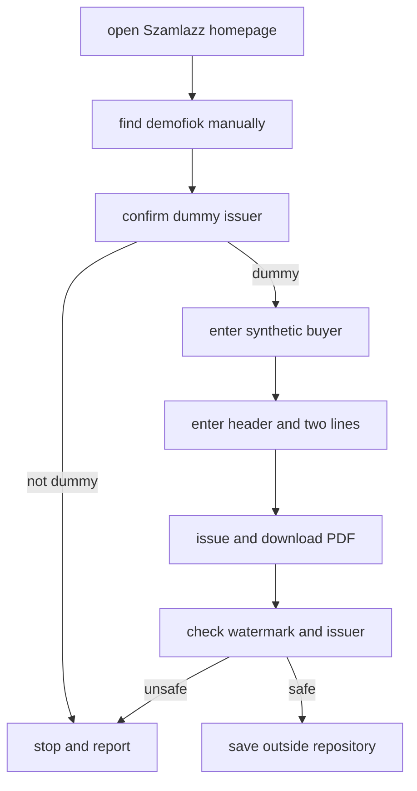

# Manual Reference Capture

`scripts/issue_demo_invoice_wizard.sh` is a human wizard for issuing a synthetic invoice in the public Számlázz.hu demófiók. It exists to collect external provider layout evidence for invoice research while the canonical deterministic examples remain the generated fixtures documented in [synthetic fixtures and golden evaluation](fixtures-and-evaluation.md).

The wizard flow is grounded in `scripts/issue_demo_invoice_wizard.sh` stages 1-7.

## What the wizard owns

The script opens the provider site in the user's browser when possible, prompts for observed URLs and issuer data, asks the user to enter a fully synthetic buyer, creates two 27% VAT invoice lines, downloads the resulting PDF, and records observations. By default it writes notes to `$HOME/document-intelligence-reference/invoices/demofiok-notes.env` and suggests saving the PDF under `$HOME/document-intelligence-reference/invoices/`, not inside the repository.

The buyer mirrors the committed `invoice/happy_path` fixture in `fixtures/catalogue.py` closely enough to compare layout, but the wizard intentionally omits the reverse-charge and TAM lines from the generated golden fixture. The source comments say this PDF is a layout reference; schema edge cases remain covered by generated fixture data tables and `expected.json` projections.

## Safety gates and boundaries

- The demófiók is chosen over a test account because the script expects a dummy issuer. If the issuer block looks like a real company or the downloaded PDF no longer looks synthetic, stop and do not keep the PDF as repository evidence.
- The buyer tax number shown by the wizard deliberately has an invalid check digit, matching the repository's fixture privacy convention. Do not correct it unless the provider rejects it; record that finding instead.
- The wizard captures observations about a third-party UI. Its output is not app configuration, not a secret-bearing `.env` for the runtime, and not a deterministic CI fixture.
- Do not commit the downloaded PDF unless a separate repository decision explicitly permits provider-generated reference files. The script currently treats it like PRADO captures: useful local evidence that stays outside version control.

## Change navigation

| Intent | Start here | Narrow validation |
| --- | --- | --- |
| Change the manual steps, prompts, or safety gates | Stage section below the `STAGES` marker in `scripts/issue_demo_invoice_wizard.sh` | Run `bash scripts/issue_demo_invoice_wizard.sh` far enough to verify prompts without entering real data |
| Change the invoice values used for comparison | `scripts/issue_demo_invoice_wizard.sh` and `fixtures/catalogue.py` `invoice/happy_path` | Re-run `uv run pytest tests/test_fixture_renderer.py` if generated fixture values change; otherwise the wizard itself is manual validation |
| Decide whether provider PDFs may become repository artifacts | Repository policy around generated/reference artifacts, then `scripts/issue_demo_invoice_wizard.sh` save step | Confirm the resulting diff contains no real issuer, secret, personal identifier, or unapproved binary |

Consult [runtime configuration and validation](../operations/runtime-and-validation.md) only when the change also affects the FastAPI, worker, database, Redis, MinIO, or Anthropic runtime. This wizard is a manual research workflow and does not submit to the local API or require the worker pipeline.
